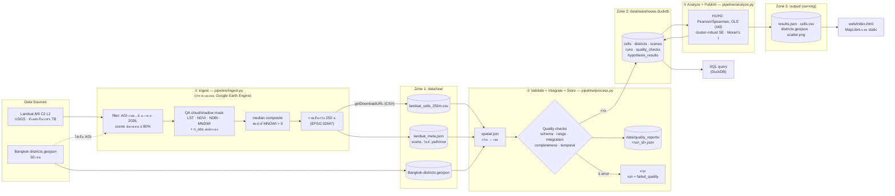
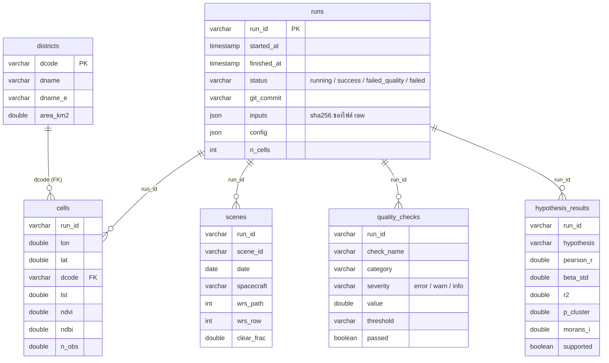

# Architecture (ฉบับ Checkpoint)

## Pipeline

รันทั้งหมดด้วยคำสั่งเดียว: `python run_pipeline.py` (หรือ `--skip-ingest` เพื่อใช้ข้อมูลดิบที่มีอยู่แล้ว)

## Data Model (DuckDB)

- `cells` เป็น fact table (1 แถวต่อกริดต่อ run) ส่วน `districts` เป็น dimension
- ทุกตารางมี `run_id` จึงเก็บผลของทุก run ไว้ได้ เทียบข้าม run ได้ และย้อนไปดูได้ว่าผลแต่ละชุดมาจาก input/config/commit ไหน
- view `latest_cells` ให้ข้อมูลของ run ล่าสุดที่สำเร็จ

## Quality Checks

| หมวด | check | ระดับ | เกณฑ์ |
|---|---|---|---|
| schema | มีคอลัมน์ครบ, เป็นตัวเลข, ไม่มีค่าว่าง, พิกัดอยู่ในกรอบ, ไม่มีกริดซ้ำ | error | 0 ปัญหา |
| range | LST | error | 20–60°C |
| range | NDVI, NDBI | error | [−1, 1] |
| integration | ครบทุกเขตหลัง spatial join | error | 50 เขต |
| integration | สัดส่วนกริดนอกเขตที่ถูกตัดทิ้ง | info | — |
| completeness | coverage ต่อเขต = กริดที่ได้ ÷ (พื้นที่เขต ÷ 0.0625 ตร.กม.) | warn | ≥ 50% |
| temporal | จำนวนวันที่ถ่ายภาพ (ไม่ซ้ำ) | error | ≥ 3 |
| temporal | สัดส่วนกริดที่มี observation ปลอดเมฆ ≥ 2 | warn | ≥ 90% |

- `error` ไม่ผ่าน → pipeline หยุด, run ถูกบันทึกเป็น `failed_quality` และไม่มีข้อมูลเข้า `cells` หรือ serving
- `warn` → ทำงานต่อได้ แต่จะแสดงผลทั้งในเว็บและใน report
- report ของทุก run ถูกเขียน**ก่อน**ตัดสินว่าจะไปต่อหรือไม่ แม้ run ที่ fail ก็ตรวจย้อนได้
- เกณฑ์ทุกข้ออยู่ใน `pipeline/config.py` ที่เดียว

## Design Decisions

| # | การตัดสินใจ | เหตุผล | Trade-off |
|---|---|---|---|
| 1 | **ประมวลผลภาพบน GEE แล้วส่งกลับมาเฉพาะผลรวมรายกริด** | ภาพ Landsat ทั้งคลังมีขนาดระดับ TB ถ้าดาวน์โหลดมาประมวลผลเองต้องใช้ storage และ compute มาก แต่ GEE ทำ filter/mask/composite ฝั่ง server แล้วส่งกลับมาแค่ประมาณ 8 MB | ต้องพึ่ง GEE (บัญชี, Cloud project, quota) จึงแก้โดย commit ข้อมูลดิบไว้ใน `data/raw/` และมี `--skip-ingest` ให้คนที่ไม่มีบัญชีรันขั้นที่เหลือได้ |
| 2 | **ใช้ไฟล์ขอบเขตเขตไฟล์เดียวกันทั้งเป็น AOI ใน GEE และใช้ join** | ขอบเขตตรงกันทั้ง pipeline ไม่ต้องพึ่ง boundary ของ GEE (FAO GAUL) ที่อาจไม่ตรงกับเขตปกครองจริง | ต้องส่ง polygon ไปกับ request จึงปัดพิกัดเหลือ 4 ตำแหน่ง (~11 ม.) เพื่อลดขนาด |
| 3 | **คำนวณ LST, NDVI, NDBI จากภาพชุดเดียวกัน** แล้วทำ median composite | ตัวแปรทั้งสามตรงกันทั้งเวลาและพื้นที่ ส่วน median ช่วยลดผลจากเมฆที่ mask ไม่หมด | เกณฑ์ปลอดเมฆ ≥ 80% ทำให้เหลือแค่ 4 วันที่ถ่าย และทุกภาพถ่ายช่วง 10:30 น. เท่านั้น |
| 4 | **ใช้กริด 250 ม. เป็นหน่วยวิเคราะห์** และเสนอผลรายเขตด้วย | ลด noise ของพิกเซล 30 ม. ใกล้เคียงความละเอียดจริงของ thermal band (100 ม.) ส่วนผลรายเขตใช้ตอบคำถามเชิงนโยบาย | ผลอาจเปลี่ยนตามขนาดกริดที่เลือก (MAUP) ยังไม่ได้ทำ sensitivity test |
| 5 | **ใช้ DuckDB (ไฟล์เดียว) เป็น warehouse** | รองรับ SQL, join, window function, ไม่ต้องมี server และกรรมการ clone ไปรันได้ทันที ข้อมูลระดับหมื่นแถวต่อ run จึงไม่ต้องใช้ระบบกระจาย | เขียนได้ทีละ process และไม่รองรับผู้ใช้หลายคนพร้อมกัน ซึ่งไม่ใช่ requirement ของงานนี้ |
| 6 | **แยก serving zone (ไฟล์ static) ออกจาก warehouse** | เว็บไม่ต้องมี backend จึง host บน GitHub Pages ได้ และ serving มีเฉพาะผลของ run ที่ผ่าน quality gate | ต้อง publish ใหม่ทุกครั้งที่รัน pipeline ซึ่ง `run_pipeline.py` ทำให้อัตโนมัติ |
| 7 | **Quality gate แบบ fail-fast + บันทึกทุก run** | ข้อมูลผิดปกติหลุดขึ้นเว็บไม่ได้ และมีหลักฐานตรวจย้อนได้ (report + ตาราง runs ที่เก็บ sha256 ของ input และ git commit) | เกณฑ์บางข้อทีมตั้งขึ้นเอง (ดู `config.py`) |
| 8 | **ตอบ H1/H2 ด้วยโมเดลแยกตัวแปร** และใช้ cluster-robust SE | NDVI กับ NDBI มี r ≈ −0.84 ถ้าใส่รวมกันในโมเดลเดียวจะเกิด suppression effect ส่วน residual มี Moran's I ≈ 0.75 ทำให้ p-value จาก OLS ต่ำเกินจริง | cluster-robust SE ง่ายกว่า spatial lag/error model แต่ไม่ได้จำลองโครงสร้างเชิงพื้นที่โดยตรง |

## เทคโนโลยีที่ไม่ได้เลือก
- **Spark / Hadoop / cloud data warehouse / AWS pipeline:** ข้อมูลหลังผ่าน GEE มีแค่ระดับ MB และรันปีละไม่กี่ครั้ง ถ้าใช้เครื่องมือพวกนี้จะเพิ่มความซับซ้อนและต้นทุนโดยไม่มี requirement รองรับ (spec ข้อ 5)
- **PostgreSQL/PostGIS:** ต้องดูแล server เพิ่ม แต่ข้อมูลมีขนาดเล็กและไม่มีการเขียนพร้อมกันหลายคน
- **Scheduler (cron/Airflow):** ข้อมูลเป็นภาพหน้าร้อนปีละครั้ง จึง trigger แบบ manual ก็พอ

